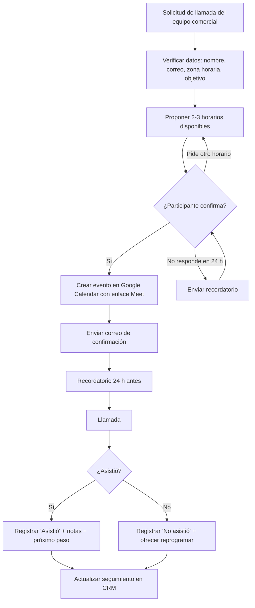

# 📞 Flujo de reserva de llamadas introductorias (práctica simulada)

> ⚠️ **Ejercicio de práctica.** Los nombres, correos, empresas y datos son ficticios.
> No corresponde a experiencia laboral real.

Autora: Ana Camila Sánchez Góngora · Práctica para el perfil de *Gestión de citas* (código GUX26-005)

## 1. Objetivo

Diseñar un proceso claro y repetible para **organizar llamadas introductorias y reuniones de equipos comerciales**:
agendar, confirmar con los participantes, registrar la asistencia y mantener el seguimiento actualizado,
cuidando la privacidad de los datos.

## 2. Herramientas utilizadas

| Necesidad | Herramienta | Uso en el ejercicio |
|---|---|---|
| Agenda | Google Calendar | Crear eventos, invitar participantes, zona horaria y recordatorios |
| Videollamada | Google Meet | Enlace automático en cada evento |
| CRM (simulado) | Google Sheets | Hoja de seguimiento con estados por contacto (ver `seguimiento_ejemplo.csv`) |
| Comunicación | Correo electrónico | Confirmaciones, recordatorios y reprogramaciones (plantillas abajo) |

## 3. Flujo del proceso

## 4. Pasos detallados

1. **Recepción:** el equipo comercial envía el contacto y el objetivo de la llamada. Se registra en el CRM con estado `Nuevo`.
2. **Validación:** se revisan nombre, correo, zona horaria y objetivo. Solo se piden los datos necesarios.
3. **Propuesta de horarios:** se envían 2–3 opciones considerando la zona horaria del participante.
4. **Agendamiento:** al confirmar, se crea el evento en Google Calendar con enlace de Meet y se invita a los participantes. Estado: `Agendada`.
5. **Confirmación:** correo con fecha, hora (con zona horaria), enlace y objetivo. Estado: `Confirmada`.
6. **Recordatorio:** mensaje 24 h antes (y notificación automática de Calendar).
7. **Registro de asistencia:** al terminar, se marca `Asistió` / `No asistió` / `Reprogramada`.
8. **Seguimiento:** se actualizan notas y próximo paso, y se informa al equipo comercial.

## 5. Estados del CRM simulado

`Nuevo` → `Agendada` → `Confirmada` → `Asistió` | `No asistió` | `Reprogramada` | `Cancelada`

## 6. Plantillas de mensajes

**Confirmación**
> Asunto: Confirmación de llamada – {fecha} {hora} ({zona horaria})
>
> Hola {nombre}, te confirmo tu llamada introductoria con {responsable comercial}.
> 📅 {fecha} · 🕒 {hora} ({zona horaria}) · 🔗 {enlace Meet}
> Objetivo: {objetivo}. Si necesitas otro horario, respóndeme a este correo.
> Saludos, Ana Camila

**Recordatorio (24 h antes)**
> Hola {nombre}, te recuerdo tu llamada de mañana a las {hora} ({zona horaria}). Enlace: {enlace Meet}. ¡Hasta pronto!

**Reprogramación tras inasistencia**
> Hola {nombre}, notamos que no pudiste conectarte. ¿Te gustaría reprogramar? Te propongo: {opción 1}, {opción 2}.

## 7. Privacidad de los datos

- Recopilar solo los datos necesarios (nombre, correo, zona horaria, objetivo).
- Compartir la hoja de seguimiento únicamente con quienes la necesitan, con permisos de edición controlados.
- Usar copia oculta (CCO) cuando haya varios participantes externos.
- No incluir información sensible en el asunto ni en las notas.
- Eliminar o anonimizar los datos cuando ya no se requieran.

## 8. Resultado

- Un flujo documentado de principio a fin, listo para aplicar con Google Calendar, un CRM y videollamadas.
- Plantillas reutilizables para confirmar, recordar y reprogramar.
- Un modelo de seguimiento con estados claros (`seguimiento_ejemplo.csv`) para saber quién asistió y cuál es el siguiente paso.
- **Aprendizaje:** la clave es confirmar siempre la zona horaria y dejar registrado el próximo paso después de cada llamada.

## 9. Próximos pasos (ideas de mejora)

- Automatizar recordatorios con Google Apps Script.
- Agregar un tablero con el porcentaje de asistencia por semana.
